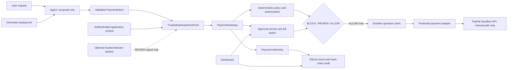

# AgentSentinel

AgentSentinel is a **production-shaped prototype**, not a production payment
service. It combines an offline AI-agent trace detector experiment with a
separate PayPal Sandbox payment-control prototype. The payment flow demonstrates
trusted authorization, deterministic policy, human review, a kill switch,
durable operation state, auditability, and a gateway boundary around a payment
adapter. The default demonstration uses only an in-process fake adapter.

## What is implemented

- **Offline detection:** synthetic customer-support traces, schema validation,
  redaction, preprocessing, contextual features, rules, and Isolation Forest.
  The learned detector **fails Gate C**: its held-out false-positive rate is
  56.9%, above the preregistered 10% ceiling. Its score is not a payment
  authorization decision. A separate trace-level 60/20/20 validation
global calibration measured 16.4% test FPR. A task-group threshold selected
only on validation measured 9.16% aggregate FPR and 60.7% recall on the
synthetic test set, but its trace-bootstrap interval extends above 10% and
one task group measured 13.2% FPR.
A zero-validation-FPR threshold detected no test anomalies (0/89), while
the rules baseline detected 25/89 with zero observed false positives in
262 normal events. These synthetic results do not qualify a production
detector. See the [ML evaluation](docs/ML_EVALUATION.md).
- **Payment safety prototype:** a `PaymentIntent` proposal passes through a
  trusted gateway, exact-bound authorization and policy checks, approval and
  kill-switch controls, an operation store, and a protected adapter. A person
  must use the documented approval path; an agent proposal does not authorize
  a payment.
- **Agent demonstration:** a LangGraph purchase agent can use a scripted
  proposer or an already-installed local Ollama model. It receives no payment
  credentials or authorization-issuance capability. Detector advisories are
  optional inputs and cannot override a deterministic `BLOCK`.
- **Local operations prototype:** authenticated localhost approval and
  dashboard routes, allowlisted payment telemetry, a local SHA-256 audit chain,
  crash recovery, and reconciliation. These features are not a hosted or
  production-ready control plane.

## Architecture



In the normal offline demo, the provider is a fake adapter and the PayPal
Sandbox node is not contacted. The guard decorator is an integration
convenience, **not a Python sandbox**. Python code in the same process must be
trusted; private-object introspection is not prevented. Do not expose provider
adapters or credentials to untrusted agent code.

## Quickstart (PowerShell)

Requires Python 3.10+ and Git. The install includes the declared `dev`, `agent`,
and `day10` optional dependency groups. No `.env`, PayPal credentials, Ollama
server, or model download is needed for these commands.

```powershell
git clone https://github.com/prasanna14200/AgentObservability.git
Set-Location AgentObservability
python -m venv .venv
.\.venv\Scripts\python.exe -m pip install -e ".[dev,agent,day10]"
.\.venv\Scripts\python.exe scripts\evaluate_offline.py
.\.venv\Scripts\python.exe -m pytest -o addopts= -q
.\.venv\Scripts\python.exe scripts\run_attack_suite.py
.\.venv\Scripts\python.exe scripts\demo_side_by_side.py
```

Run the evaluation before the full suite: it generates ignored synthetic
processed data used by one feature test. On the verified Python 3.10.11
environment, the fresh-clone sequence produced:

- Evaluation exit 0; 620 traces and 1,831 events; `gate_c_pass: false`.
- Full tests: **331 passed**, one Starlette/AnyIO deprecation warning, exit 0.
- Attack suite: **22/22 passed**, no live PayPal calls.
- Side-by-side demo exit 0:

  | Path | Decision | Status | Reason | Fake money moved |
  |---|---|---|---|---:|
  | Unprotected mock | ALLOW | COMPLETED | UNPROTECTED_MOCK_ONLY | USD 9.00 |
  | AgentSentinel | BLOCK | REJECTED | AUTHORIZATION_MERCHANT_MISMATCH | USD 0.00 |

These are observed local results, not a guarantee for every platform. The
offline evaluation is synthetic and separate from payment safety. Its
customer-support Isolation Forest result is PR-AUC 0.706 and FPR 56.9%; the
rules baseline is PR-AUC 0.463 and FPR 0%. Gate C therefore fails the registered
10% FPR ceiling.

To start the localhost-only approval service and dashboard after installing
the `day10` optional dependencies:

```powershell
.\.venv\Scripts\python.exe run.py
```

Set `APPROVER_SECRET` in the process environment or enter a value of at least
32 characters when the hidden-input prompt appears. The startup command never
prints the secret and strips PayPal-related variables from the service
process. Visit `http://127.0.0.1:8000/dashboard`; do not expose this prototype
to a public network. `/health` is liveness; `/ready` checks only local
approval-store kill-switch availability.

## Local Docker demo (SQLite prototype only)

The local Compose profile binds the dashboard to loopback and stores current
SQLite payment, approval, and telemetry data in a named Docker volume. It does
not include PayPal credentials, enable Sandbox dispatch, or use PostgreSQL.
This is a reproducible local demo container, not the production deployment
architecture. The PostgreSQL migration boundary and safe cutover requirements
are documented in [the migration plan](docs/POSTGRESQL_MIGRATION_PLAN.md).

Create a separate local approver secret file without displaying its value:

```powershell
New-Item -ItemType Directory -Force secrets | Out-Null
$rng = [System.Security.Cryptography.RandomNumberGenerator]::Create()
$bytes = New-Object byte[] 48
$rng.GetBytes($bytes)
[System.IO.File]::WriteAllText(
    (Join-Path $PWD 'secrets\approver_secret'),
    [Convert]::ToBase64String($bytes)
)
[Array]::Clear($bytes, 0, $bytes.Length)
$rng.Dispose()
Remove-Variable rng, bytes
```

Build and run locally:

```powershell
docker compose build
docker compose up -d
docker compose ps
```

Open `http://127.0.0.1:8000`. The app uses a read-only container filesystem,
non-root user, dropped Linux capabilities, a read-only mounted secret, and a
persistent named volume. Do not run `docker compose down -v` unless you
intentionally want to delete all local demo state. The Compose health check
only exercises the current SQLite `/ready` endpoint; it is not production
dependency monitoring or a backup check. Docker build/runtime has not been
verified on this workstation because the Docker Engine is unavailable.

The volume is local persistence, not a backup. No restore drill, PostgreSQL
backend, or public deployment is implemented. Do not put PayPal credentials in
the approver-secret file or pass provider secrets to this container.

## Optional local Ollama experiment

This experiment requires Ollama and the named model to already be installed.
The script does not download a model. It is not part of the default quickstart:

```powershell
.\.venv\Scripts\python.exe scripts\run_local_llm_trials.py --model qwen2.5:1.5b
```

In the recorded five-trial run, all five local proposals changed the merchant
or amount in response to poisoned catalog text. The gateway blocked all five
with `AUTHORIZATION_MERCHANT_MISMATCH`; the mock moved USD 0.00. This is a
small controlled experiment with one model, not a prompt-injection coverage or
model robustness claim.

## PayPal Sandbox boundary

The source implements PayPal REST calls for OAuth
(`POST /v1/oauth2/token`), Orders
(`POST /v2/checkout/orders`, `GET /v2/checkout/orders/{id}`, and
`POST /v2/checkout/orders/{id}/capture`), and capture lookup
(`GET /v2/payments/captures/{id}`). The ordinary quickstart, tests, attack
suite, evaluation, and side-by-side demo use no PayPal transport. The separate
manual Sandbox walkthrough in
[Day 7 documentation](docs/paypal_hackathon/07_end_to_end_gateway.md) can make
real Sandbox requests when explicitly configured and run; do not run it as part
of the offline demo.

Day 7 Order A remains unresolved: subsequent read-only provider GETs returned
HTTP 404, so its outcome is not claimed. A separate Order B capture was
independently verified through read-only order and capture GETs. See the
[troubleshooting record](docs/paypal_hackathon/07_sandbox_404_troubleshooting.md).

## Reproducibility and limitations

- [Demo runbook](docs/DEMO_RUNBOOK.md)
- [Master Phase 0–29 reconciliation and feature audit](docs/ROADMAP_RECONCILIATION.md)
- [Security threat model](docs/SECURITY_THREAT_MODEL.md)
- [Configuration and deployment boundary](docs/CONFIGURATION.md)
- [Validation-calibrated ML evaluation](docs/ML_EVALUATION.md)
- [Devpost draft](docs/devpost_description.md)
- [Video script](docs/video_script.md)
- [Hackathon Day handoffs and status](docs/paypal_hackathon/PROGRESS.md)
- [Day 14 guard quickstart](docs/paypal_hackathon/14_quickstart.md)

The GitHub repository currently has no configured Actions workflows, so there
is no hosted CI result to report. Use the local commands above. SQLite, local
process boundaries, and the audit chain are prototype controls: this project
does not promise external exactly-once payment execution, cancellation of an
already admitted provider call, tamper-proof audit storage, production
authentication, or isolation of arbitrary Python code.

## License

Apache-2.0. See [LICENSE](LICENSE).
